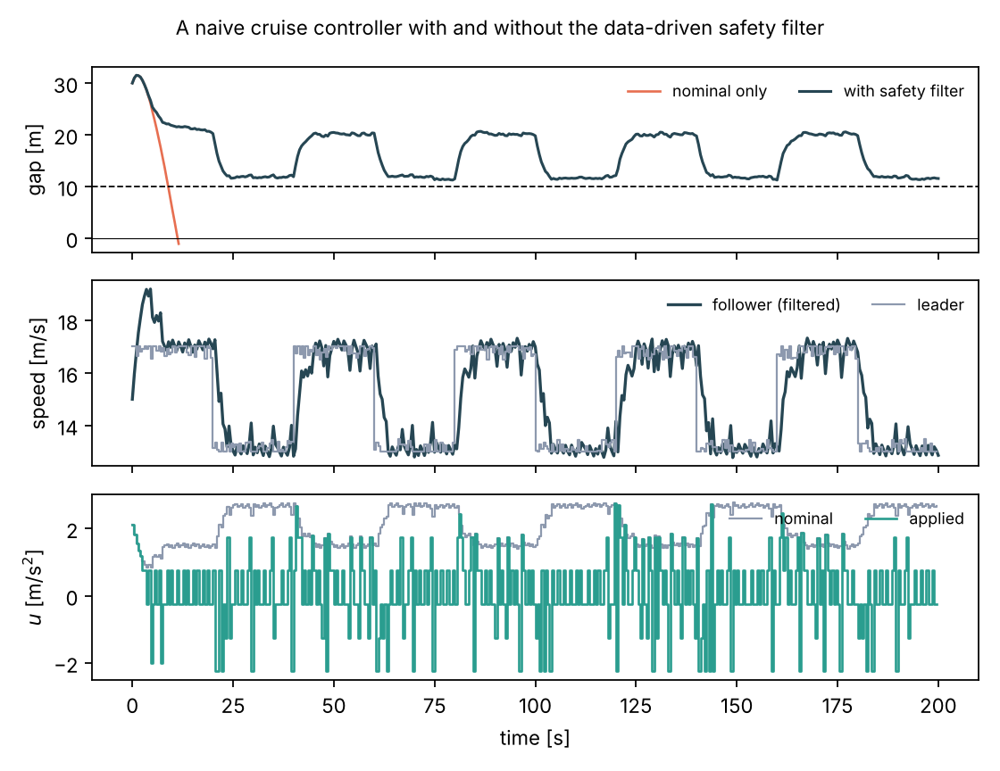
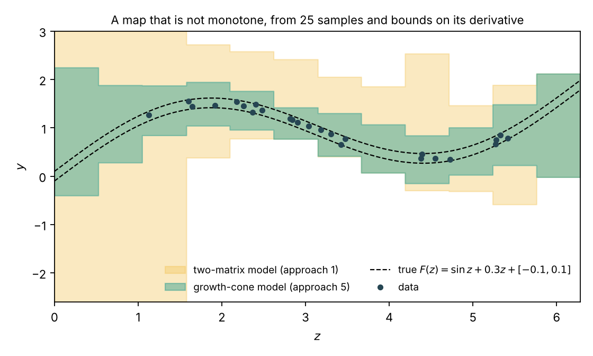
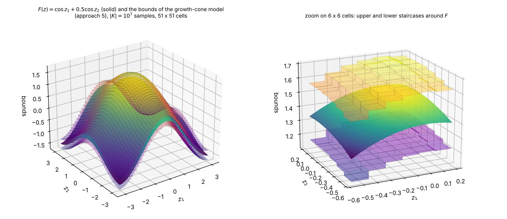
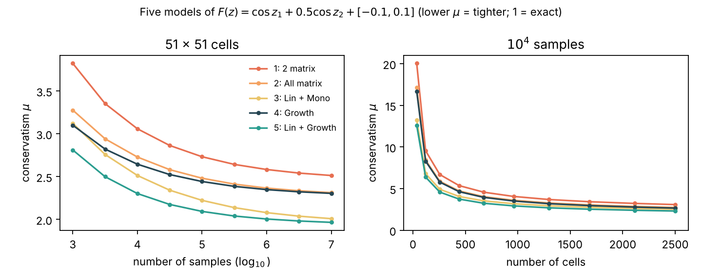
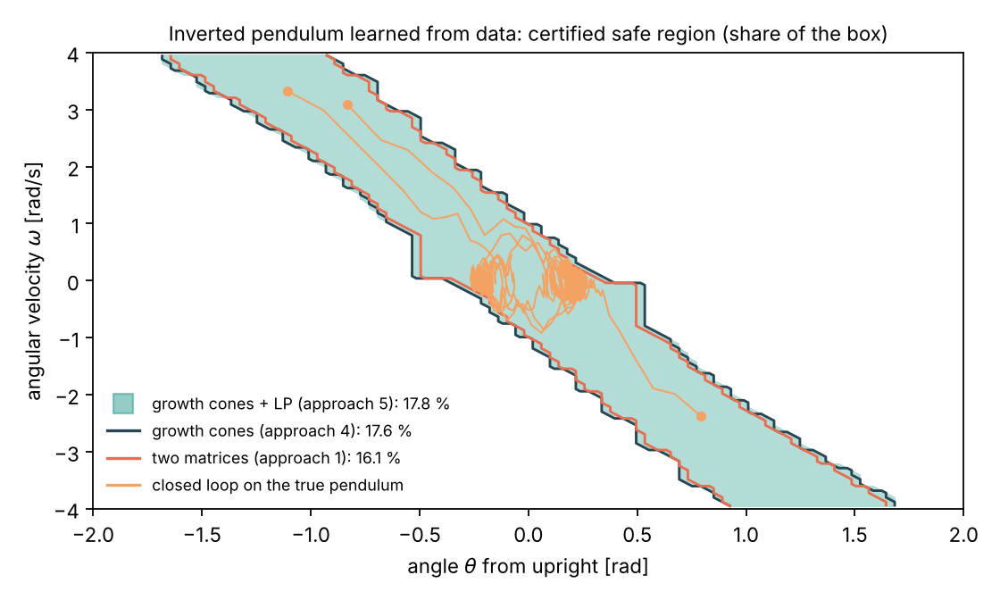
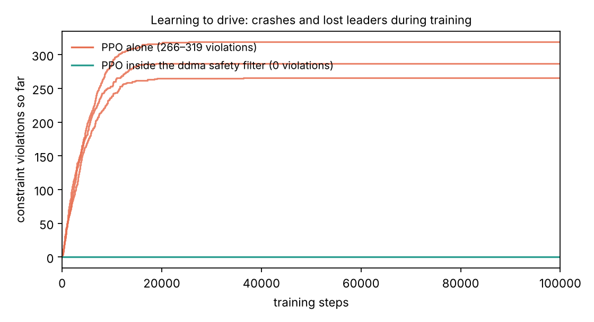
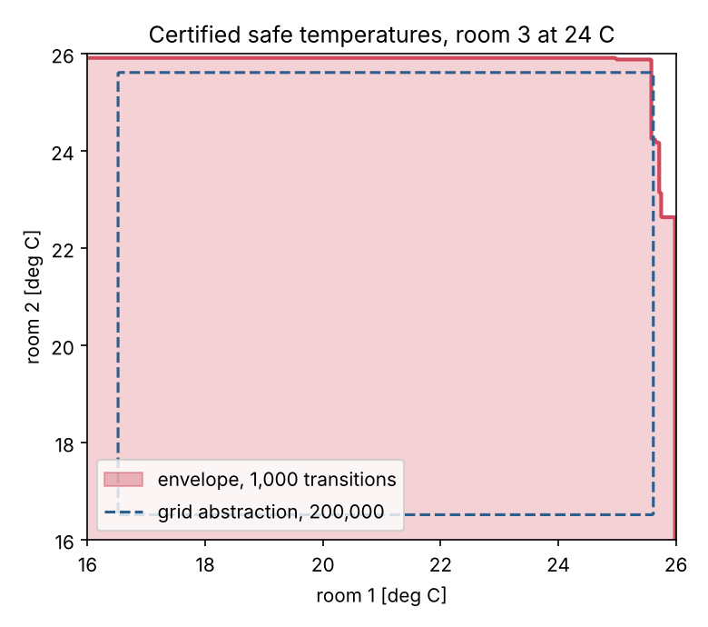

# ddma: data-driven models and abstractions

**Learn a guaranteed model of an unknown system from data, then synthesize controllers that are provably safe for the real system.**

`ddma` implements the minimal simulating maps from

> A. Makdesi, A. Girard, L. Fribourg. *Data-Driven Models of Monotone Systems.* IEEE Transactions on Automatic Control, 69, pp. 5294–5309, 2024. [doi:10.1109/TAC.2023.3346793](https://doi.org/10.1109/TAC.2023.3346793)

and models of systems that are **not monotone but have bounded derivatives** (TAC 2024, Section III-C, and the five approaches of the PhD thesis, Chapter 3), with the symbolic abstractions and controller synthesis built on top of them (L4DC 2021, ADHS 2021), and **safe envelopes computed straight from data, without a grid** (IFAC World Congress 2026). More model classes are planned (see the roadmap).

**Python and MATLAB.** Both interfaces share one C++ core, they are tested against each other, and the experiments of the three papers and of the thesis chapter are reproduced (see [docs/REPRODUCTION.md](docs/REPRODUCTION.md)). Every feature is in both languages, and the MATLAB results are checked against Python's in CI: see [docs/PARITY.md](docs/PARITY.md) for the name of each function in each language.


## The idea

Suppose part of your system's dynamics is unknown, but you know a little about its shape:

- it is **monotone**: larger states and inputs lead to larger next states (true for many thermal, traffic, vehicle and chemical processes); or
- its **partial derivatives are bounded**: each output changes at most so fast, in each direction, with each state and input (true for most physical systems; the bounds can also be estimated from data, with a probabilistic guarantee);
- and the disturbance is bounded by known limits.

From a set of measured transitions, `ddma` computes a **set-valued model** that is guaranteed to contain the true system. No model class is fitted. For monotone systems the model is:

- **sound**: it contains every monotone system that could have produced the data, so it contains the true one;
- **minimal**: no smaller set-valued model has that guarantee (proved in the TAC paper);
- **fast to compute**: on a grid with |Q| cells and |K| samples it takes O(|K| log|Q| + |Q|) time, in a compiled C++ kernel: 10 million samples take 0.2 s;
- **easy to update**: new data refines the model by intersection, without revisiting the old data.

For systems with bounded derivatives, five models trade tightness against speed (below); all are sound, can be updated with new data, and the growth-cone models can be updated locally while the system runs.

The learned model gives a finite abstraction of the system. Controllers synthesized on it (safety, reach-avoid) carry over to the real system with guarantees.

## Example: a safety filter for adaptive cruise control, learned from data

A follower car must keep a gap of 10–50 m to a leader whose speed varies anywhere in 13–17 m/s. **The follower's speed dynamics (drag, actuator) are unknown.** We only know they are monotone in speed and acceleration command.

From sampled transitions, `ddma` learns the speed dynamics, builds a 6,600-state abstraction and computes the maximal set of states from which safety can be guaranteed against every leader behaviour. The resulting controller is then used as a **safety filter** around a naive cruise controller that ignores the leader.




| samples | certified safe region (% of the specification) | learn model | build abstraction | synthesis |
|---:|---:|---:|---:|---:|
| 2,000 | 26.7 % | 0.001 s | 0.05 s | 0.003 s |
| 20,000 | 37.1 % | 0.001 s | 0.04 s | 0.003 s |
| 200,000 | 38.1 % | 0.007 s | 0.04 s | 0.003 s |

Times measured on a single CPU core in a cloud container; they vary from run to run.

Without the filter, the naive controller drops below the 10 m gap after 9 s and collides at 11.5 s. With the filter, the gap stays above 11 m for the full 200 s.

(`python examples/adaptive_cruise_control.py` reproduces the table and figures.)

## Systems that are not monotone: bounded derivatives

Many dynamics are not monotone: a pendulum's acceleration grows with the angle up to 90° and then falls. What is usually known is how fast each output can change with each variable, i.e. bounds on the partial derivatives. From such bounds and data, `BoundedDerivativeModel` learns a guaranteed model on a grid of cells. It implements the five approaches of the thesis (Chapter 3), chosen with `method=`:

| `method=` | idea | when to use it |
|---|---|---|
| `"two_matrix"` (default) | subtract the steepest linear trends so that two monotone functions remain, learn both, intersect | fastest; a cell stays unbounded until some data point lies on the right side of it for both transforms |
| `"all_matrix"` | the same with every combination of slopes per output (2ⁿ monotone maps, one per orientation) | tighter, bounds every cell |
| `"growth"` | each sample bounds the function inside a cone set by the derivative bounds; the tightest bound at every grid vertex is computed exactly, in one forward and one backward sweep per axis | as tight as `"all_matrix"`, bounds every cell, can be updated locally online (`update_local`) |
| `"lin_mono"`, `"lin_growth"` | the same with a small linear program per cell for the final step | tightest; slower on large grids (bounds certified by duality, so solver tolerances cannot make them unsound) |



With 25 samples and no data near the ends of the interval, both models bound the whole interval; the growth-cone model is tighter, most of all far from the data (mean width 1.24 against 1.51). (`python examples/bounded_derivative_map.py`, or `run examples/bounded_derivative_map` in MATLAB)

In two dimensions the model is a pair of staircases, one value per cell, around the unknown function. Here the growth-cone model with the linear-programming step (approach 5) learned from 10⁷ samples of F(z) = cos z₁ + 0.5 cos z₂ + [−0.1, 0.1] on 51 × 51 cells (the example of thesis Section 3.4); the zoom shows the steps:



**Comparing the five models.** On the two-dimensional example of the thesis, the ranking holds at every amount of data: the growth cones with the linear-programming step are the tightest, and all models get tighter with more data and finer grids. (`python reproductions/thesis_ch3.py`, details in [docs/REPRODUCTION.md](docs/REPRODUCTION.md).)



**Example: keeping an inverted pendulum upright.** The pendulum's dynamics are learned from 10⁶ transitions on θ ∈ [−2, 2] rad, where they are not monotone, with only the derivative bounds known. On 101 × 101 state cells and 25 input cells, the certified safe region (states from which the pendulum can be kept within the box forever, with torque |u| ≤ 6) covers 16.1 % of the box with the two-matrix model and 17.8 % with the growth cones + LP; every model's controller gives 0 violations in 100 closed-loop runs on the true pendulum.



| model | learn model | build abstraction | synthesis | safe region |
|---|---:|---:|---:|---:|
| `two_matrix` | 0.2 s | 0.1 s | 0.01 s | 16.1 % |
| `all_matrix` | 1.1 s | 0.1 s | 0.01 s | 17.4 % |
| `growth` | 0.2 s | 0.1 s | 0.01 s | 17.6 % |
| `lin_mono` | 23 s | 0.1 s | 0.01 s | 17.6 % |
| `lin_growth` | 26 s | 0.1 s | 0.01 s | 17.8 % |

(`python examples/pendulum_bounded_derivatives.py`; times on one CPU core, indicative.)

## Reinforcement learning that never violates its constraints

`ddma.rl.SafetyFilterWrapper` puts a learned safety controller around any [Gymnasium](https://gymnasium.farama.org) environment: each action of the agent passes unchanged if it is safe and is replaced by the nearest safe action otherwise. From a state in the controller's domain the system stays safe for ever, whatever the agent does, during training as well. In MATLAB, `ddma.safe_step` / `ddma.safe_reset` wrap the step and reset functions of an environment in the form used by the Reinforcement Learning Toolbox (`rlFunctionEnv`).

```python
from ddma.rl import SafetyFilterWrapper
env = SafetyFilterWrapper(gym_env, controller)   # controller = ddma.safety(...)
model = PPO("MlpPolicy", env).learn(100_000)    # any agent, any library
```

On the cruise-control task (`ddma.rl.CruiseControlEnv`: drive close to 22 m/s behind a leader that switches between about 13 and 17 m/s; a crash or a lost leader ends the episode), PPO alone crashes or loses the leader 266–319 times while it learns (3 seeds, 100,000 steps each). Inside the filter, built from 200,000 logged transitions without the vehicle model, it has 0 violations in training and evaluation, and ends with a slightly higher return.



(`python examples/rl_safety_filter.py`, needs `pip install "ddma[rl-demo]"`; MATLAB: `run examples/rl_safety_filter`.)

## Safe envelopes without a grid

`ddma.invariance` computes a controlled invariant set directly from the transitions, with no partition and no abstraction: every state in the envelope can be kept in it forever, for every disturbance within the bounds, with the inputs the envelope certifies. Two methods:

- `monotone_envelope` (monotone systems, lower-closed specifications such as "every temperature at most 26 °C"): the envelope is a union of lower sets, stored as a few corner points, each with the largest input that keeps everything below it there.
- `embedding_envelope` (any system with bounds on its Jacobian): every pair of data points spans a box; the growth cones of the two points bound where the box can go (an LP, solved here exactly in closed form), and boxes that map into themselves are kept.

```python
from ddma import monotone_envelope
env = monotone_envelope(X, X_next, U, w_lo=0, w_hi=0.15, input_signs=[-1], x_hi=[26, 26, 26])
env.contains(x)                 # certified?
u = env.safe_input(x, u_wanted) # closest certified input (None outside)
```

Three rooms cooled by one input, unknown heat gains up to 0.15 °C per step, limit 26 °C: from 1,000 transitions the envelope certifies about 98 % of the safe temperature range in under a second; the grid abstraction of `examples/lazy_synthesis.py` certifies about 74 % from 200,000 transitions. For non-monotone systems, 400 transitions of a two-species competition model certify about 84 % of its operating range, and a ring of ten coupled nonlinear units is handled from 1,000 transitions in a fraction of a second.



(`python examples/envelope_room_cooling.py`, `python examples/envelope_nonlinear.py`; MATLAB: `ddma.monotone_envelope`, `ddma.embedding_envelope`, examples of the same names. Details: [docs/INVARIANCE.md](docs/INVARIANCE.md).)

## Install

**Python**

```bash
pip install -e .              # NumPy only; builds the C++ kernel if a compiler is available
pip install -e ".[examples]"  # + matplotlib, scipy (examples and derivative-bound estimation)
pip install -e ".[dev]"       # + pytest and ruff
```

Without a C++ compiler the package falls back to NumPy, which gives identical results, only slower. `ddma.compiled_backend_available()` tells you which backend is in use.

**MATLAB / Octave**

```matlab
cd matlab
build_mex                         % optional: compiles the same C++ kernels as MEX files
run examples/acc_safety_filter    % the cruise-control example below, in MATLAB
run examples/pendulum_bounded_derivatives   % a non-monotone system: bounded-derivative models
run examples/online_refinement    % learning while running: the safe region grows, 0 violations
run examples/lazy_synthesis       % lazy abstraction: a few percent of the transitions evaluated
addpath tests; run_tests          % checks the MATLAB code against Python reference results
```

The `+ddma` package mirrors the Python API with functions on structs: `ddma.fit`, `ddma.bd_fit` (the five bounded-derivative models; same struct as `ddma.fit`, so it goes straight into `ddma.abstraction`), `ddma.growth_map`, `ddma.estimate_derivative_bounds`, `ddma.bd_update` / `ddma.bd_update_local` / `ddma.abstraction_refresh` / `ddma.safety(..., known_winning)` (online refinement), `ddma.abstraction(..., lazy)`, `ddma.safety`, `ddma.reach_avoid`, `ddma.controller_input` (which includes the safety filter), `ddma.simulate`, and the partition helpers. [docs/PARITY.md](docs/PARITY.md) lists every Python name with its MATLAB counterpart.

## Quick start

```python
import numpy as np
from ddma import MinimalSimulatingMap, PartitionedSimulatingMap, RectangularPartition

# data from an unknown monotone map with disturbance in [-0.1, 0.1]
rng = np.random.default_rng(0)
Z = rng.uniform(0, 1, size=(1000, 2))
Y = Z[:, :1] ** 2 + np.tanh(Z[:, 1:]) + rng.uniform(-0.1, 0.1, size=(1000, 1))

# exact minimal simulating map, evaluated pointwise
S = MinimalSimulatingMap(Z, Y, d_lo=-0.1, d_hi=0.1)
lo, hi = S.bounds([[0.5, 0.5]])        # every consistent system maps (0.5, 0.5) into [lo, hi]

# the same on a fixed 50 x 50 grid, computed once for all cells
grid = RectangularPartition.uniform([0, 0], [1, 1], [50, 50])
sigma = PartitionedSimulatingMap.from_data(Z, Y, grid, d_lo=-0.1, d_hi=0.1)
sigma = sigma.update(Z_new, Y_new)     # refine later with new data (Z_new, Y_new)
```

From a model to a controller, for x⁺ ∈ f(x, u) + g(x, u) + D with f unknown and monotone, and g known:

```python
from ddma import SymbolicAbstraction, affine_bounds, safety, transitions_to_data

Zd, Y = transitions_to_data(X, U, X_next, g)          # y = x' - g(x, u)
sigma = PartitionedSimulatingMap.from_data(Zd, Y, RectangularPartition.product(Xgrid, Ugrid),
                                           d_lo, d_hi)
abst = SymbolicAbstraction(Xgrid, Ugrid, sigma, g_bounds=affine_bounds(A, B))
ctrl = safety(abst, abst.cells_inside(safe_lo, safe_hi))

u = ctrl.filter(x, u_nominal)   # closest certified-safe input to u_nominal
```

When f is not monotone but its partial derivatives are bounded (df_i/dx_j in [A_lo, A_hi], df_i/du_j in [B_lo, B_hi]), the model replaces the simulating map, and g is passed to it:

```python
from ddma import BoundedDerivativeModel, estimate_derivative_bounds

# bounds known from physics, or estimated from data (scenario approach):
# a_lo, a_hi, w = estimate_derivative_bounds(np.hstack([X, U]), X_next - g(X, U))
grid = RectangularPartition.product(Xgrid, Ugrid)
model = BoundedDerivativeModel.from_data(X, U, X_next, grid, A_lo, A_hi, B_lo, B_hi,
                                         d_lo, d_hi, g=g, g_bounds=affine_bounds(A, B),
                                         method="growth")
abst = SymbolicAbstraction(Xgrid, Ugrid, model)
ctrl = safety(abst, abst.cells_inside(safe_lo, safe_hi))

# online: refine near new data, update only what changed, keep the old safe set
model.update_local(x_new, u_new, x_next_new, window=3)
abst.refresh()
ctrl = safety(abst, abst.cells_inside(safe_lo, safe_hi), known_winning=ctrl.domain)
```

For one scalar function on its own (e.g. a vehicle's turn rate as a function of speed and steering), `GrowthMap` is the same growth-cone model without the system structure:

```python
from ddma import GrowthMap

grid = RectangularPartition.uniform([0.1, -0.79], [2.0, 0.79], [40, 40])   # (speed, steering)
w = GrowthMap.from_data(Z, y, grid, g_lo=[-10, 1], g_hi=[10, 40], d_lo=-0.05, d_hi=0.05)
lo, hi = w.bounds(z_query)       # guaranteed bounds on f(z) + d at the cells of z_query
w.update(z_new[None], [y_new])   # one measurement at a time: about 0.1 ms on this grid
```

## What's in the package

| module | contents | source |
|---|---|---|
| `MinimalSimulatingMap` | exact minimal simulating map, bounds on f, set-membership estimate, merging data sets, consistency check of the monotonicity assumption | TAC paper |
| `PartitionedSimulatingMap` | tightest interval map on a fixed rectangular partition (O(\|K\| log\|Q\| + \|Q\|) sweep), incremental updates; the data-induced partition recovers the exact minimal map | TAC paper |
| sign patterns (`signs=`) | known increasing (+1) / decreasing (−1) / no (0) dependence per output and input | ±1: order transformation for unknown linear functions (thesis Ch. 2); 0: extension in this package |
| `SymbolicAbstraction` | finite abstraction of x⁺ ∈ f(x,u) + g(x,u) + D; successors stored as boxes of cells; `features=` for unknown parts that depend on a subset of (x, u) | L4DC 2021, ADHS 2021, TAC paper |
| `ddma.rl.SafetyFilterWrapper`, `CruiseControlEnv` | certified safety filter around any Gymnasium environment (actions corrected to the nearest safe one; initial states redrawn into the controller's domain; optional penalty per correction); a cruise-control RL benchmark | |
| `ddma.invariance`: `monotone_envelope`, `embedding_envelope` | safe envelopes (controlled invariant sets) from data without a grid: maximal corners of lower sets for monotone systems (layered search with dominance pruning + sort-filter skyline, equal to exhaustive enumeration); invariant boxes spanned by pairs of data points for systems with bounded Jacobians (the pair LP solved exactly in closed form); `contains`, `safe_input` | IFAC WC 2026 (Makdesi & Zamani; Makdesi, Zamani & Jafarpour) |
| `safety`, `reach_avoid` | maximal controlled invariant set; reach-avoid with step counts. Exact fixed points in the C++ core: summed-area tables check a successor box in O(2^n); in `safety` each state keeps a pointer to its first input not yet ruled out, so every state–input pair is examined at most once over the whole fixed point; `reach_avoid` re-examines a state only when its successor hull gained a winning cell | standard fixed points |
| `SymbolicAbstraction(..., lazy=True)` | no transitions stored: `safety` evaluates a transition only when its scan reaches it (states outside the safe set are never expanded, each state stops at its first good input). Memory O(\|Q\|) instead of O(\|Q\|·\|P\|); the controller computes its allowed inputs on demand. Same winning set | standard fixed point, transitions computed on demand |
| `Controller` | concrete inputs (`pick=`), **safety filter** (`filter`), closed-loop `simulate` | |
| `BoundedDerivativeModel` | unknown dynamics that are *not* monotone but have bounded partial derivatives. `method=`: `"two_matrix"` (two monotone maps, intersected; default), `"all_matrix"` (all sign combinations of the derivative bounds), `"growth"` (growth cones evaluated at the grid vertices, exact set-membership values there in one sweep per axis), and `"lin_mono"`, `"lin_growth"` (the same with a linear-programming final step, tightest). `update` adds data exactly; `update_local` (growth cones) updates only a window of cells around each new point, for online use. `local="cell"` / `"slab"` (growth cones) also intersects with the cones of the data points in each cell / in its slabs; `"slab"` is never looser than the min over data of each cone's max over the cell | TAC, Prop. 8; thesis Ch. 3 |
| `GrowthMap` | the growth-cone model for one scalar function on its own: exact `update` (a per-point path for online use gives the same model as a batch refit), `update_local`, `bounds`, `f_bounds` | thesis Ch. 3 |
| online refinement | `SymbolicAbstraction.refresh()` recomputes only the transitions of the states changed by `update_local`; `safety(..., known_winning=previous_set)` updates the maximal invariant set exactly, keeping the previous set (which stays controlled invariant when the model is refined) | |
| `estimate_derivative_bounds`, `scenario_confidence` | derivative and disturbance bounds from data, with the scenario-approach guarantee | TAC, Sec. IV, Prop. 9 |
| `SymbolicAbstraction(..., assumption=)` | assume-guarantee contracts (e.g. "if the leader's speed stays in [a, b] …") | ADHS, TAC |
| `cpp/ddma_core.hpp`, `cpp/ddma_synthesis.hpp`, `cpp/ddma_growth.hpp` | header-only C++ kernels used by both the Python and MATLAB interfaces: map fitting (float64, or float32 with outward rounding), the synthesis fixed points, and the growth-cone fits (vertex values and the cell/slab maps, the latter in time independent of the slab size) | |
| `ddma.plotting` | paper-style figures: transparent staircase bounds, 3-D and 2-D sets | |

## Reproducing the papers

`reproductions/` re-runs the numerical experiments of L4DC 2021, ADHS 2021, TAC 2024 and Chapter 3 of the thesis, and [docs/REPRODUCTION.md](docs/REPRODUCTION.md) compares the results with the papers. Highlights:

- TAC Figs. 9–10: µ = 2.70 → 2.47 as the data grow from 10⁶ to 10⁷ samples, matching the paper.
- L4DC: the exact abstraction from 300 transitions (27 million state–input pairs) and its invariant set take 6 s instead of 923 s + 341 s.
- TAC Lorenz example at the paper's full size (10⁸ samples, 104 million cells) on an 8 GB machine: 223 s instead of 929 s, using per-output inputs, float32 bounds and batched data. Its maximal controlled invariant set (1 million states × 101 inputs) then takes 6 s.
- Thesis Ch. 3: the five bounded-derivative approaches rank as in the thesis at every data size (Lin + Growth tightest); all contain the true map.
- Every synthesized controller is checked in closed loop on the true plant: 0 violations.
- Settings the papers leave implicit (L4DC input range, ADHS experiment settings, LP weighting for the Lorenz example) are documented in the report.

## How it's tested

The Python tests are in `tests/` and run in about 10 s with `pytest`. They check the guarantees rather than the outputs alone:

- **Soundness**: the true system lies inside the learned map on thousands of random queries, for random monotone functions and sign patterns.
- **Minimality**: the bounds are attained by monotone functions consistent with the data.
- **Fast algorithms against brute force**: the grid sweep equals the theorem's formula exactly, on random non-uniform partitions with data on cell edges and outside the box. Safety and reach-avoid fixed points equal the textbook iterations (sets, step counts and allowed inputs) on random abstractions in dimensions 1–4, with every index type, in both backends.
- **Bounded-derivative models**: all five approaches are sound for random functions with bounded derivatives, with data outside the box and a known part g. The growth-cone vertex values equal the set-membership bounds computed by brute force over all data, and the cell bounds equal their definition; restricted to two sign matrices, the all-matrix model equals the two-matrix one; `update` equals a refit on all data; the windowed update tightens exactly the window. The linear-programming final steps are certified by weak duality, so solver tolerances cannot make them unsound.
- **Original implementation**: the grid algorithm reproduces the original MATLAB implementation (`Data2Sigma0` + `ApproximationMonotoneSystemData3`) bit for bit on random problems.
- **Backends and languages**: the C++ and NumPy backends are bit-identical. The MATLAB code, both pure `.m` and MEX, reproduces the Python results exactly (map, abstraction, safety, reach-avoid; the five bounded-derivative models to within 1e-15, and their online updates), and the MEX fixed points equal the `.m` ones on random 1-D to 3-D abstractions. It has been run in MATLAB (MATLAB Online: tests, examples and figures) and CI runs it under Octave.
- **Safe envelopes**: the monotone search equals brute-force enumeration; the closed-form pair bound equals an LP solver; every certified corner or box is pushed through the true dynamics with random inputs and worst-case disturbances, and closed loops from thousands of certified states never leave the envelope (Python and MATLAB, MATLAB checked against Python).
- **Closed loop**: simulated trajectories under the synthesized controllers and the safety filter never leave the safe set and always reach the target.

## Roadmap

Next: faster learning kernels (multithreading), documentation site and pre-built wheels. See [docs/ROADMAP.md](docs/ROADMAP.md).

## Authors

- **Anas Makdesi**: implementation and maintenance.
- **Antoine Girard** (Université Paris-Saclay, CNRS, CentraleSupélec, L2S) and **Laurent Fribourg** (Université Paris-Saclay, CNRS, ENS Paris-Saclay, LMF): co-authors of the methods implemented here (L4DC 2021, ADHS 2021, TAC 2024) and supervisors of the PhD thesis.
- **Majid Zamani** (University of Colorado Boulder; LMU Munich) and **Saber Jafarpour** (University of Colorado Boulder): co-authors of the safe-envelope methods (`ddma.invariance`, IFAC World Congress 2026).

The methods come from the papers above. This package was rewritten from the original MATLAB research code with the help of Claude (Anthropic): the Python package, the C++ core, the MATLAB interface, the tests and the reproductions of the papers' experiments.

## Citing

If you use this software, please cite the TAC paper (see `CITATION.cff`), for the bounded-derivative models also the thesis, and for the safe envelopes the IFAC 2026 papers (Makdesi & Zamani, *Data-driven synthesis of controlled invariant sets for monotone systems*; Makdesi, Zamani & Jafarpour, *Data-driven controlled invariance via monotone embeddings*):

```bibtex
@article{makdesi2024datadriven,
  title   = {Data-Driven Models of Monotone Systems},
  author  = {Makdesi, Anas and Girard, Antoine and Fribourg, Laurent},
  journal = {IEEE Transactions on Automatic Control},
  volume  = {69},
  pages   = {5294--5309},
  year    = {2024},
  doi     = {10.1109/TAC.2023.3346793}
}

@phdthesis{makdesi2023thesis,
  title  = {Data-driven abstractions for the safe learning of nonlinear systems},
  author = {Makdesi, Anas},
  school = {Universit{\'e} Paris-Saclay},
  year   = {2023},
  note   = {NNT 2023UPASG103, HAL tel-04611772}
}
```

## License

MIT, see `LICENSE`.
