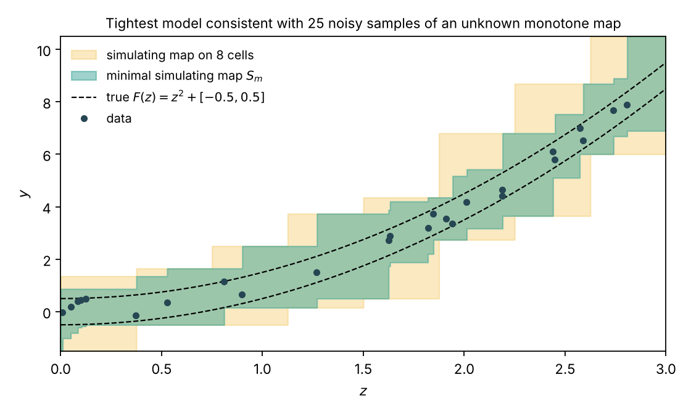
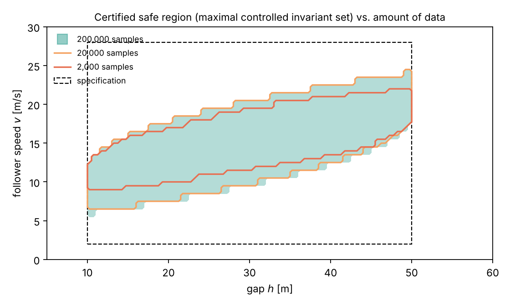

# ddma: data-driven models and abstractions

**Learn a guaranteed model of an unknown system from data, then synthesize controllers that are provably safe for the real system.**

`ddma` implements the minimal simulating maps from

> A. Makdesi, A. Girard, L. Fribourg. *Data-Driven Models of Monotone Systems.* IEEE Transactions on Automatic Control, 69, pp. 5294–5309, 2024. [doi:10.1109/TAC.2023.3346793](https://doi.org/10.1109/TAC.2023.3346793)

It also provides models for systems with bounded derivatives (TAC 2024, Section III-C; five approaches from the thesis, Chapter 3), and the symbolic abstractions and controller synthesis built on top of them (L4DC 2021, ADHS 2021). More model classes are planned (see the roadmap).

**Python and MATLAB.** Both interfaces share one C++ core, they are tested against each other, and the experiments of all three papers are reproduced (see [docs/REPRODUCTION.md](docs/REPRODUCTION.md)).



## The idea

Suppose part of your system's dynamics is unknown, but you know two things about it:

- it is **monotone**: larger states and inputs lead to larger next states (true for many thermal, traffic, vehicle and chemical processes);
- the disturbance is bounded by known limits.

From a set of measured transitions, `ddma` computes the **tightest set-valued model** that is guaranteed to contain the true system. No model class is fitted and no Lipschitz constant has to be guessed. The model is:

- **sound**: it contains every monotone system that could have produced the data, so it contains the true one;
- **minimal**: no smaller set-valued model has that guarantee (proved in the TAC paper);
- **fast to compute**: on a grid with |Q| cells and |K| samples it takes O(|K| log|Q| + |Q|) time, in a compiled C++ kernel: 10 million samples take 0.2 s;
- **easy to update**: new data refines the model by intersection, without revisiting the old data.

The learned model gives a finite abstraction of the system. Controllers synthesized on it (safety, reach-avoid) carry over to the real system with guarantees.

## Example: a safety filter for adaptive cruise control, learned from data

A follower car must keep a gap of 10–50 m to a leader whose speed varies anywhere in 13–17 m/s. **The follower's speed dynamics (drag, actuator) are unknown.** We only know they are monotone in speed and acceleration command.

From sampled transitions, `ddma` learns the speed dynamics, builds a 6,600-state abstraction and computes the maximal set of states from which safety can be guaranteed against every leader behaviour. The resulting controller is then used as a **safety filter** around a naive cruise controller that ignores the leader.




| samples | certified safe region (% of the specification) | learn model | build abstraction | synthesis |
|---:|---:|---:|---:|---:|
| 2,000 | 26.7 % | 0.001 s | 0.05 s | 0.003 s |
| 20,000 | 37.1 % | 0.001 s | 0.04 s | 0.003 s |
| 200,000 | 38.1 % | 0.007 s | 0.04 s | 0.003 s |

Times measured on a single CPU core in a cloud container; they vary from run to run.

Without the filter, the naive controller drops below the 10 m gap after 9 s and collides at 11.5 s. With the filter, the gap stays above 11 m for the full 200 s.

(`python examples/adaptive_cruise_control.py` reproduces the table and figures.)

## Install

**Python**

```bash
pip install -e .              # NumPy only; builds the C++ kernel if a compiler is available
pip install -e ".[examples]"  # + matplotlib, scipy (examples and derivative-bound estimation)
pip install -e ".[dev]"       # + pytest and ruff
```

Without a C++ compiler the package falls back to NumPy, which gives identical results, only slower. `ddma.compiled_backend_available()` tells you which backend is in use.

**MATLAB / Octave**

```matlab
cd matlab
build_mex                         % optional: compiles the same C++ kernels as MEX files
run examples/acc_safety_filter    % the cruise-control example below, in MATLAB
addpath tests; run_tests          % checks the MATLAB code against Python reference results
```

The `+ddma` package mirrors the Python API: `ddma.fit`, `ddma.msm_bounds`, `ddma.abstraction`, `ddma.safety`, `ddma.reach_avoid`, `ddma.controller_input` (which includes the safety filter), and the partition helpers.

## Quick start

```python
import numpy as np
from ddma import MinimalSimulatingMap, PartitionedSimulatingMap, RectangularPartition

# data from an unknown monotone map with disturbance in [-0.1, 0.1]
rng = np.random.default_rng(0)
Z = rng.uniform(0, 1, size=(1000, 2))
Y = Z[:, :1] ** 2 + np.tanh(Z[:, 1:]) + rng.uniform(-0.1, 0.1, size=(1000, 1))

# exact minimal simulating map, evaluated pointwise
S = MinimalSimulatingMap(Z, Y, d_lo=-0.1, d_hi=0.1)
lo, hi = S.bounds([[0.5, 0.5]])        # every consistent system maps (0.5, 0.5) into [lo, hi]

# the same on a fixed 50 x 50 grid, computed once for all cells
grid = RectangularPartition.uniform([0, 0], [1, 1], [50, 50])
sigma = PartitionedSimulatingMap.from_data(Z, Y, grid, d_lo=-0.1, d_hi=0.1)
sigma = sigma.update(Z_new, Y_new)     # refine later with new data (Z_new, Y_new)
```

From a model to a controller, for x⁺ ∈ f(x, u) + g(x, u) + D with f unknown and monotone, and g known:

```python
from ddma import SymbolicAbstraction, affine_bounds, safety, transitions_to_data

Zd, Y = transitions_to_data(X, U, X_next, g)          # y = x' - g(x, u)
sigma = PartitionedSimulatingMap.from_data(Zd, Y, RectangularPartition.product(Xgrid, Ugrid),
                                           d_lo, d_hi)
abst = SymbolicAbstraction(Xgrid, Ugrid, sigma, g_bounds=affine_bounds(A, B))
ctrl = safety(abst, abst.cells_inside(safe_lo, safe_hi))

u = ctrl.filter(x, u_nominal)   # closest certified-safe input to u_nominal
```

## What's in the package

| module | contents | source |
|---|---|---|
| `MinimalSimulatingMap` | exact minimal simulating map, bounds on f, set-membership estimate, merging data sets, consistency check of the monotonicity assumption | TAC paper |
| `PartitionedSimulatingMap` | tightest interval map on a fixed rectangular partition (O(\|K\| log\|Q\| + \|Q\|) sweep), incremental updates; the data-induced partition recovers the exact minimal map | TAC paper |
| sign patterns (`signs=`) | known increasing (+1) / decreasing (−1) / no (0) dependence per output and input | ±1: order transformation for unknown linear functions (thesis Ch. 2); 0: extension in this package |
| `SymbolicAbstraction` | finite abstraction of x⁺ ∈ f(x,u) + g(x,u) + D; successors stored as boxes of cells; `features=` for unknown parts that depend on a subset of (x, u) | L4DC 2021, ADHS 2021, TAC paper |
| `safety`, `reach_avoid` | maximal controlled invariant set; reach-avoid with step counts. Exact fixed points in the C++ core: summed-area tables check a successor box in O(2^n); in `safety` each state keeps a pointer to its first input not yet ruled out, so every state–input pair is examined at most once over the whole fixed point; `reach_avoid` re-examines a state only when its successor hull gained a winning cell | standard fixed points |
| `SymbolicAbstraction(..., lazy=True)` | no transitions stored: `safety` evaluates a transition only when its scan reaches it (states outside the safe set are never expanded, each state stops at its first good input). Memory O(\|Q\|) instead of O(\|Q\|·\|P\|); the controller computes its allowed inputs on demand. Same winning set. Python only | standard fixed point, transitions computed on demand |
| `Controller` | concrete inputs (`pick=`), **safety filter** (`filter`), closed-loop `simulate` | |
| `BoundedDerivativeModel` | unknown dynamics that are *not* monotone but have bounded partial derivatives. `method=`: `"two_matrix"` (two monotone maps, intersected; default), `"all_matrix"` (all sign combinations of the derivative bounds), `"growth"` (growth cones evaluated at the grid vertices, exact set-membership values there in one sweep per axis), and `"lin_mono"`, `"lin_growth"` (the same with a linear-programming final step, tightest). `update` adds data exactly; `update_local` (growth cones) updates only a window of cells around each new point, for online use | TAC, Prop. 8; thesis Ch. 3 |
| `estimate_derivative_bounds`, `scenario_confidence` | derivative and disturbance bounds from data, with the scenario-approach guarantee | TAC, Sec. IV, Prop. 9 |
| `SymbolicAbstraction(..., assumption=)` | assume-guarantee contracts (e.g. "if the leader's speed stays in [a, b] …") | ADHS, TAC |
| `cpp/ddma_core.hpp`, `cpp/ddma_synthesis.hpp` | header-only C++ kernels used by both the Python and MATLAB interfaces: map fitting (float64, or float32 with outward rounding) and the synthesis fixed points | |
| `ddma.plotting` | paper-style figures: transparent staircase bounds, 3-D and 2-D sets | |

## Reproducing the papers

`reproductions/` re-runs the numerical experiments of L4DC 2021, ADHS 2021, TAC 2024 and Chapter 3 of the thesis, and [docs/REPRODUCTION.md](docs/REPRODUCTION.md) compares the results with the papers. Highlights:

- TAC Figs. 9–10: µ = 2.70 → 2.47 as the data grow from 10⁶ to 10⁷ samples, matching the paper.
- L4DC: the exact abstraction from 300 transitions (27 million state–input pairs) and its invariant set take 6 s instead of 923 s + 341 s.
- TAC Lorenz example at the paper's full size (10⁸ samples, 104 million cells) on an 8 GB machine: 223 s instead of 929 s, using per-output inputs, float32 bounds and batched data. Its maximal controlled invariant set (1 million states × 101 inputs) then takes 6 s.
- Every synthesized controller is checked in closed loop on the true plant: 0 violations.
- Settings the papers leave implicit (L4DC input range, ADHS experiment settings, LP weighting for the Lorenz example) are documented in the report.

## How it's tested

The Python tests are in `tests/` and run in about 9 s with `pytest`. They check the guarantees rather than the outputs alone:

- **Soundness**: the true system lies inside the learned map on thousands of random queries, for random monotone functions and sign patterns.
- **Minimality**: the bounds are attained by monotone functions consistent with the data.
- **Fast algorithms against brute force**: the grid sweep equals the theorem's formula exactly, on random non-uniform partitions with data on cell edges and outside the box. Safety and reach-avoid fixed points equal the textbook iterations (sets, step counts and allowed inputs) on random abstractions in dimensions 1–4, with every index type, in both backends.
- **Bounded-derivative models**: all five approaches are sound for random functions with bounded derivatives, with data outside the box and a known part g. The growth-cone vertex values equal the set-membership bounds computed by brute force over all data, and the cell bounds equal their definition; restricted to two sign matrices, the all-matrix model equals the two-matrix one; `update` equals a refit on all data; the windowed update tightens exactly the window. The linear-programming final steps are certified by weak duality, so solver tolerances cannot make them unsound.
- **Original implementation**: the grid algorithm reproduces the original MATLAB implementation (`Data2Sigma0` + `ApproximationMonotoneSystemData3`) bit for bit on random problems.
- **Backends and languages**: the C++ and NumPy backends are bit-identical. The MATLAB code, both pure `.m` and MEX, reproduces the Python results exactly (map, abstraction, safety, reach-avoid), and the MEX fixed points equal the `.m` ones on random 1-D to 3-D abstractions. It has been run in MATLAB (MATLAB Online: tests, examples and figures) and CI runs it under Octave.
- **Closed loop**: simulated trajectories under the synthesized controllers and the safety filter never leave the safe set and always reach the target.

## Roadmap

Next: a Gymnasium safety filter for reinforcement learning, online refinement (safe learning-based MPC), partition optimisation, and pre-built wheels. See [docs/ROADMAP.md](docs/ROADMAP.md).

## Authors

- **Anas Makdesi**: implementation and maintenance.
- **Antoine Girard** (Université Paris-Saclay, CNRS, CentraleSupélec, L2S) and **Laurent Fribourg** (Université Paris-Saclay, CNRS, ENS Paris-Saclay, LMF): co-authors of the methods implemented here (L4DC 2021, ADHS 2021, TAC 2024).

The methods come from the papers above. This package was rewritten from the original MATLAB research code with the help of Claude (Anthropic): the Python package, the C++ core, the tests and the reproductions of the papers' experiments.

## Citing

If you use this software, please cite the TAC paper (see `CITATION.cff`):

```bibtex
@article{makdesi2024datadriven,
  title   = {Data-Driven Models of Monotone Systems},
  author  = {Makdesi, Anas and Girard, Antoine and Fribourg, Laurent},
  journal = {IEEE Transactions on Automatic Control},
  volume  = {69},
  pages   = {5294--5309},
  year    = {2024},
  doi     = {10.1109/TAC.2023.3346793}
}
```

## License

MIT, see `LICENSE`.
