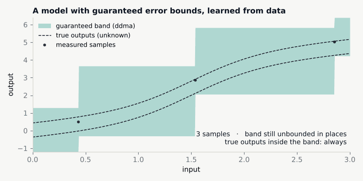

# ddma: data-driven models and abstractions

**Learn a guaranteed model of an unknown system from data, then build controllers that are provably safe for the real system.**

[](https://github.com/anas-makdesi/ddma/actions/workflows/ci.yml)
[](https://pypi.org/project/ddma/)
[](https://pypi.org/project/ddma/)
[](https://github.com/anas-makdesi/ddma/blob/main/LICENSE)
[](https://anas-makdesi.github.io/ddma/)



*An unknown increasing function, measured with bounded noise: the band ddma computes tightens as data arrives and always contains the true outputs ([script](https://github.com/anas-makdesi/ddma/blob/main/examples/demo_gif.py)).*

## Install

```bash
pip install ddma
```

**MATLAB** (R2023b or newer): download `ddma-<version>.mltbx` from the [releases page](https://github.com/anas-makdesi/ddma/releases) and open it in MATLAB.

Python 3.10 or newer. Pre-built for Linux (x86_64, ARM), Windows (x86_64) and macOS (Apple silicon: macOS 15 or newer; Intel: macOS 14 or newer), with the compiled kernels and threads included; on other systems pip builds from source. The MATLAB toolbox has pre-built MEX files for Linux, Windows and macOS on Apple silicon, and runs as plain `.m` code elsewhere. Optional extras, installing from a clone, and Octave: [installation guide](https://anas-makdesi.github.io/ddma/getting-started/installation.html).

## What it does

You have measured transitions of a system whose dynamics are partly unknown. You don't know a formula, but you know a little about its shape: the unknown part is **monotone** (larger states and inputs give larger next states, as in many thermal, traffic, vehicle and chemical processes) or its **derivatives are bounded**, and the disturbance is bounded. From the data, ddma computes a **set-valued model that is guaranteed to contain the true system**, with no model class fitted. For monotone systems it is the tightest such model. On top of it, ddma builds a finite abstraction and synthesizes controllers (safety, reach-avoid) whose guarantees carry over to the real system, for example as a **safety filter** around any other controller, including a learning agent. It can also compute safe operating envelopes straight from the data, without a grid, and check online that new data still agree with the assumptions.

**Python and MATLAB.** Both interfaces share one C++ core, every feature is in both languages, and CI checks that they give the same results.

## Example

25 noisy samples of an unknown increasing function. The only assumptions are that it is increasing and that the noise is at most 0.5. Where can the next measurement at z = 1.5 be?

```python
import numpy as np
from ddma import MinimalSimulatingMap

# 25 noisy samples of an unknown increasing function (here z², which ddma never sees)
rng = np.random.default_rng(0)
Z = rng.uniform(0, 3, size=(25, 1))
Y = Z**2 + rng.uniform(-0.5, 0.5, size=Z.shape)

S = MinimalSimulatingMap(Z, Y, d_lo=-0.5, d_hi=0.5)    # assumptions: increasing, |d| <= 0.5
lo, hi = S.bounds([[1.5]])
print(f"guaranteed: f(1.5) + d in [{lo[0, 0]:.2f}, {hi[0, 0]:.2f}]")   # true: [1.75, 2.75]
```

```matlab
ddma.seed(0);
Z = 3 * rand(25, 1);                    % 25 noisy samples of an unknown increasing function
Y = Z.^2 + (rand(25, 1) - 0.5);         % (here z², which ddma never sees)
[lo, hi] = ddma.msm_bounds(Z, Y, -0.5, 0.5, 1.5);   % assumptions: increasing, |d| <= 0.5
fprintf('guaranteed: f(1.5) + d in [%.2f, %.2f]\n', lo, hi);
```

(MATLAB draws different random numbers, so its interval differs.) Evaluated everywhere, the bounds form the band below: it contains every increasing function that could have produced the data, so it contains the true one, and no method can give a tighter guarantee from the same information. The yellow band is the same model on a grid of 8 cells, the form used to build controllers.


The first tutorial explains this example step by step; the second takes the same idea to a certified safety filter for a car.

## Documentation

**Documentation: [anas-makdesi.github.io/ddma](https://anas-makdesi.github.io/ddma/).** The site has seven tutorials that walk through the toolbox from a scalar map to the assumption monitor, executed on every build so their outputs are those of the current code, with the MATLAB version of each one; and an API reference for both languages, generated from the docstrings and the MATLAB help text.

1. [The tightest model consistent with data](https://anas-makdesi.github.io/ddma/tutorials/01-scalar-map.html): the example above, and why the model is sound and minimal.
2. [From data to a certified safe controller](https://anas-makdesi.github.io/ddma/tutorials/02-cruise-control.html): cruise control from logged transitions; abstraction, safe set, safety filter, reach-avoid.
3. [Systems that are not monotone: bounded derivatives](https://anas-makdesi.github.io/ddma/tutorials/03-pendulum.html): the five bounded-derivative models on an inverted pendulum; estimating derivative bounds from data.
4. [Learning while running](https://anas-makdesi.github.io/ddma/tutorials/04-online-learning.html): local and batch updates, a safe set that grows during operation, lazy abstractions.
5. [A learning agent inside a certified safety filter](https://anas-makdesi.github.io/ddma/tutorials/05-rl-safety-filter.html): any Gymnasium environment (MATLAB: Reinforcement Learning Toolbox).
6. [Safe envelopes straight from data, without a grid](https://anas-makdesi.github.io/ddma/tutorials/06-gridless-envelopes.html): controlled invariant sets from the transitions alone.
7. [What if the assumptions are wrong?](https://anas-makdesi.github.io/ddma/tutorials/07-assumption-monitor.html): checking data before learning and while the system runs, and responding.

Also: [Python and MATLAB names side by side](https://anas-makdesi.github.io/ddma/guides/parity.html), [performance and threads](https://anas-makdesi.github.io/ddma/guides/performance.html), [reproductions of the papers](https://anas-makdesi.github.io/ddma/guides/reproduction.html), [how it's tested](https://anas-makdesi.github.io/ddma/guides/testing.html), [changelog](https://anas-makdesi.github.io/ddma/about/changelog.html).

The scripts behind the figures and numbers below are in [`examples/`](https://github.com/anas-makdesi/ddma/tree/main/examples) (Python) and [`matlab/examples/`](https://github.com/anas-makdesi/ddma/tree/main/matlab/examples); they come with a clone of the repository (`pip install ddma` installs the package only). The MATLAB toolbox includes its examples; to run one: `cd(fullfile(fileparts(fileparts(which('ddma.fit'))), 'examples')); scalar_map`.

## Highlights

- **Fast:** a model from 10 million samples in 0.2 s, in compiled C++ on all cores, with results that are bit-identical for any number of threads.
- **A safety filter learned from data:** a cruise controller that ignores the car in front collides after 11.5 s; behind a filter learned from logged transitions, without the vehicle model, the gap stays above 11 m (limit 10 m) for the whole 200 s run ([tutorial 2](https://anas-makdesi.github.io/ddma/tutorials/02-cruise-control.html)).
- **Reinforcement learning without violations:** an agent (PPO) learning cruise control alone crashes or loses the leader 266–319 times during training; inside the filter, 0 times, in training and evaluation ([tutorial 5](https://anas-makdesi.github.io/ddma/tutorials/05-rl-safety-filter.html)).
- **Not only monotone systems:** an inverted pendulum learned with only bounds on its derivatives; 0 violations in 100 closed-loop runs on the true system ([tutorial 3](https://anas-makdesi.github.io/ddma/tutorials/03-pendulum.html)).
- **No grid needed:** a safe envelope from 1,000 transitions covers about 98 % of the safe temperatures of a three-room cooling problem, against about 74 % for a grid abstraction from 200,000 ([tutorial 6](https://anas-makdesi.github.io/ddma/tutorials/06-gridless-envelopes.html)).
- **Knows when its assumptions break:** an alarm is a proof that no system satisfying the assumptions could produce the data; under 1 ms per step with 2 million stored points ([tutorial 7](https://anas-makdesi.github.io/ddma/tutorials/07-assumption-monitor.html)).

The methods come from peer-reviewed papers (IEEE TAC 2024, L4DC 2021, ADHS 2021, IFAC World Congress 2026) and a PhD thesis; their numerical experiments are [reproduced](https://anas-makdesi.github.io/ddma/guides/reproduction.html).

## How it's tested

Over 490 tests check the guarantees, not only the outputs:

- **Soundness and minimality:** the true system lies inside every learned model, on random systems; the bounds are attained by systems consistent with the data.
- **Fast algorithms against brute force:** the grid algorithms, the synthesis fixed points, the envelopes and the monitor equal their textbook definitions on random problems.
- **Two languages, one result:** the C++, NumPy and MATLAB code (`.m` and MEX) give the same results, checked in CI in Octave and in MATLAB R2023b.
- **Every package:** each wheel runs the whole test suite in CI, and the MATLAB toolbox is installed and run in a fresh MATLAB.

Details: [how it's tested](https://anas-makdesi.github.io/ddma/guides/testing.html).

## Authors

- **Anas Makdesi**: implementation and maintenance.
- **Antoine Girard** (Université Paris-Saclay, CNRS, CentraleSupélec, L2S) and **Laurent Fribourg** (Université Paris-Saclay, CNRS, ENS Paris-Saclay, LMF): co-authors of the methods implemented here (L4DC 2021, ADHS 2021, TAC 2024) and supervisors of the PhD thesis.
- **Majid Zamani** (University of Colorado Boulder; LMU Munich) and **Saber Jafarpour** (University of Colorado Boulder): co-authors of the safe-envelope methods (`ddma.invariance`, IFAC World Congress 2026).

The methods come from the papers above. This package was rewritten from the original MATLAB research code with the help of Claude (Anthropic): the Python package, the C++ core, the MATLAB interface, the tests and the reproductions of the papers' experiments.

## Citing

If you use this software, please cite the TAC paper (see `CITATION.cff`), for the bounded-derivative models also the thesis, and for the safe envelopes the IFAC 2026 papers (Makdesi & Zamani, *Data-driven synthesis of controlled invariant sets for monotone systems*; Makdesi, Zamani & Jafarpour, *Data-driven controlled invariance via monotone embeddings*):

```bibtex
@article{makdesi2024datadriven,
  title   = {Data-Driven Models of Monotone Systems},
  author  = {Makdesi, Anas and Girard, Antoine and Fribourg, Laurent},
  journal = {IEEE Transactions on Automatic Control},
  volume  = {69},
  pages   = {5294--5309},
  year    = {2024},
  doi     = {10.1109/TAC.2023.3346793}
}

@phdthesis{makdesi2023thesis,
  title  = {Data-driven abstractions for the safe learning of nonlinear systems},
  author = {Makdesi, Anas},
  school = {Universit{\'e} Paris-Saclay},
  year   = {2023},
  note   = {NNT 2023UPASG103, HAL tel-04611772}
}
```

## License

MIT, see `LICENSE`.
