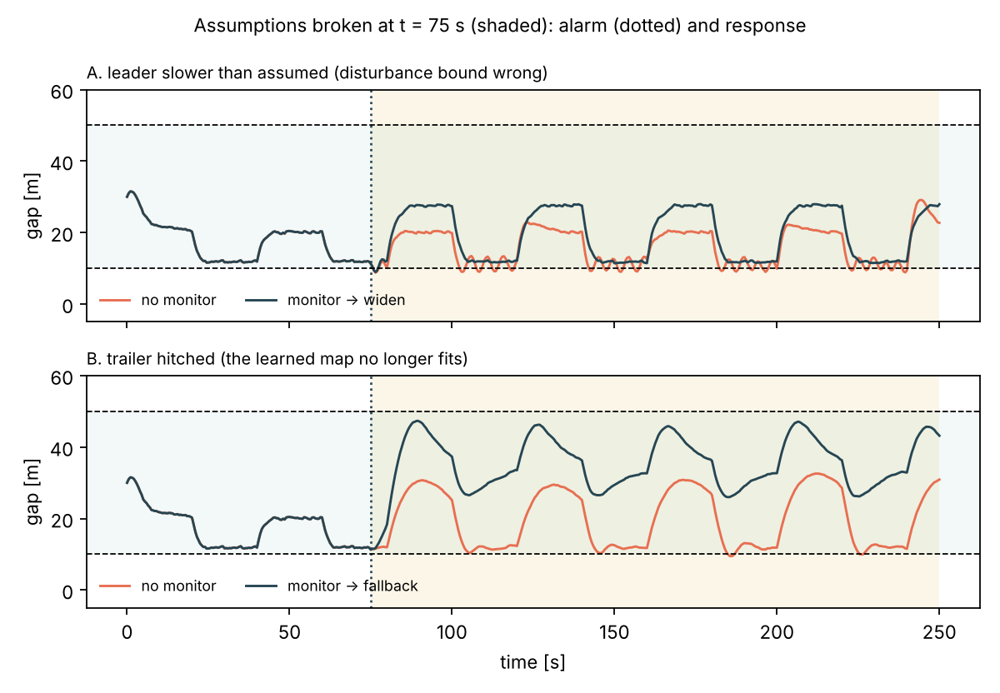

# Assumption monitor

Every guarantee in ddma is conditional: the models are sound *if* the unknown system satisfies the assumptions given to them (a monotonicity sign pattern, bounds on partial derivatives, bounds on the disturbance). `ddma.AssumptionMonitor` (MATLAB: `ddma.monitor*`) checks new data against these assumptions while the system runs, says which assumption the data contradict and by how much, and responds.

## One form for all models

Each assumption becomes an interval of slopes per output *i* and input *j*, plus a disturbance width θᵢ = d_hi,i − d_lo,i:

| assumption | slope interval of ∂fᵢ/∂zⱼ |
|---|---|
| sign +1 (non-decreasing) | [0, ∞) |
| sign −1 (non-increasing) | (−∞, 0] |
| sign 0, or *j* not a feature of output *i* | [0, 0] |
| bounded derivatives (any method) | [g_lo, g_hi] (for `two_matrix`, `all_matrix`, `lin_mono`: [min(g_lo, 0), max(g_hi, 0)], the interval these methods rely on) |

Two data points *a*, *b* are consistent with the assumptions if and only if, for every output *i*,

  y_a,i − y_b,i ≤ θᵢ + Σⱼ sᵢⱼ(z_a,j − z_b,j),  sᵢⱼ(t) = max(g_hi,ij t, g_lo,ij t).

This is the growth cone of point *b* containing point *a*; for sign patterns it is the consistency condition of the minimal simulating map (TAC paper). Each new transition is checked against every stored data point. With a model attached (`for_model`), it is also checked against the model's bounds at its cell, which are sound if the assumptions hold. Both checks give **proofs**: a violation cannot happen under correct assumptions and correct data, so the monitor never raises a false alarm. Fewer stored points (`max_points`) means fewer violations are detected, but each one is still a proof.

## Which assumption?

A violated pair can be repaired by changing one assumption, keeping all others fixed:

- the disturbance width θᵢ must grow by the gap;
- the upper bound g_hi,ij can repair it only if z_a,j > z_b,j, and must reach r_j / (z_a,j − z_b,j), where r_j = y_a,i − y_b,i − θᵢ − Σ_{k≠j} sᵢₖ(z_a,k − z_b,k);
- the lower bound g_lo,ij can repair it only if z_a,j < z_b,j, and must reach the same ratio.

Widening one bound never breaks a pair that was consistent before. So the extreme of these values over all violating pairs seen so far is **exactly the smallest change of that one assumption that makes all stored data consistent** (`needed()`); a bound that cannot repair some violating pair is ruled out. The tests check this exactness by bisection and brute force.

Data alone cannot always tell the assumptions apart: a wrong sign and a large disturbance can explain the same pair. The report therefore lists every assumption that could explain the violations on its own, with the change it needs, and the ones that cannot. The size of the change usually settles it. In the cruise-control example, the trailer could be explained by "speed update decreasing in v with slope −2,600" or by "disturbance width 0.1 → 1.2". Only the second is physically plausible: something outside the model is acting on the speed.

## Responses

| `on_violation` | what happens |
|---|---|
| `"alarm"` (default) | record the violation, call `callback(violations)` |
| `"widen"` | apply the smallest change (× (1 + `margin`)) of the `widen` target (`"disturbance"` by default, or one slope bound); `needs_refit` is set and the model must be relearned from `data()`. **The guarantees then hold for assumptions fitted to the data seen so far, not given in advance.** |
| `"fallback"` | latch `fallback_active` (until `reset()`), so the application can switch to a backup controller |

## Example

`examples/assumption_monitor.py` (MATLAB: `matlab/examples/assumption_monitor.m`) uses the cruise-control safety filter. At t = 75 s, one assumption breaks in each of two scenarios. A slower leader breaks a disturbance bound: the monitor names the disturbance as the only possible explanation, widens it and recomputes the safe set. A hitched trailer breaks the learned map: the monitor switches to a backup controller. Results with 200,000 learning transitions:

| scenario | no monitor | with monitor |
|---|---|---|
| leader slows to 11 m/s (assumed ≥ 13) | 54 steps outside the specification | 3 steps (only right after the change), safe set refit to 29 % |
| trailer: 30 % of the acceleration, twice the drag | 6 steps outside the specification | 0 steps (fallback from the first inconsistent transition) |

A violation of the assumptions can break the specification within the very step it happens (here, a leader braking harder than assumed while the follower is already at the edge of the safe set). No monitor can prevent that. What the monitor gives is the first moment when it is *known* that the guarantee no longer holds, together with the size of the problem.
